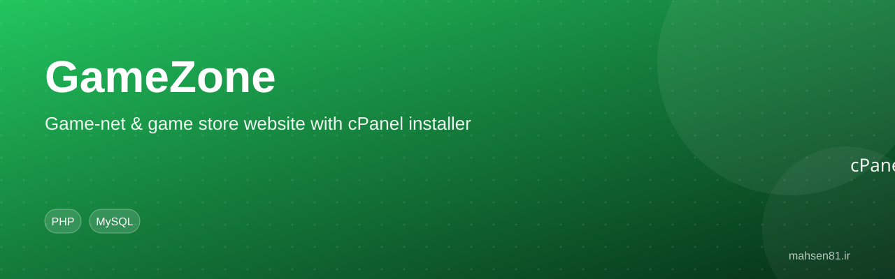

<!-- gen:header -->
<p align="center"></p>

<h1 align="center">GameZone</h1>
<p align="center"><b>سایت گیم‌نت و فروشگاه بازی با نصب‌کننده‌ی cPanel</b><br><i>Game-net & game store website with cPanel installer</i></p>
<p align="center"> </p>

<div dir="rtl">

## ✨ امکانات

- اسلایدر و معرفی بازی‌ها
- نصب‌کننده‌ی خودکار جدول‌ها
- پشتیبانی کامل فارسی

</div>

## 🚀 Quick start

```bash
See gamezone/INSTALL-CPANEL.md
```

---

<p align="center">ساخته‌شده توسط <a href="https://mahsen81.ir"><b>محسن جباره‌اصل</b></a> — برنامه‌نویسی، طراحی سایت، ربات و هوش مصنوعی<br>
Built by <a href="https://mahsen81.ir">Mohsen Jabbareh-Asl</a> · ⭐ اگر مفید بود، ستاره بدهید · Need a custom version? <a href="https://mahsen81.ir">Get in touch</a></p>
